<div align="center">

# 🅿️ Smart Parking: RFID Access Module

**A 2-slot smart parking scale model driven by MIFARE RFID cards.**
ESP32 + RC522 at the gate · Node.js/SQLite backend as the single source of truth · operator dashboard · mobile web app


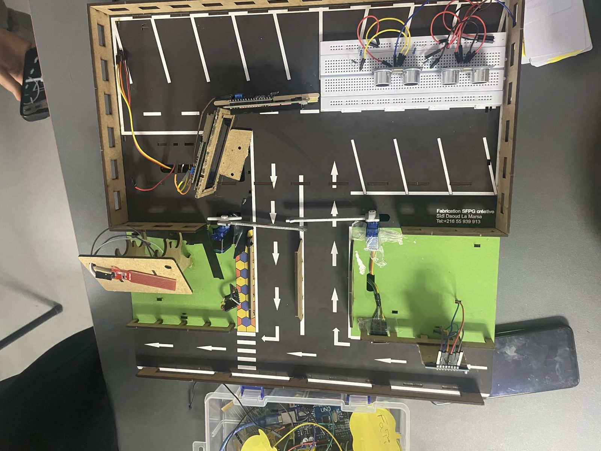

*The finished scale model: RC522 reader at the entrance, two SG90 barriers, LCD, two HC-SR04 slot sensors and the rain sensor.*

</div>

---

## Contents

- [What it does](#what-it-does)
- [Architecture](#architecture)
- [Repository layout](#repository-layout)
- [Firmware (ESP32)](#firmware-esp32)
- [Backend (Node.js + SQLite)](#backend-nodejs--sqlite)
- [Frontend: operator dashboard](#frontend-operator-dashboard)
- [Frontend: mobile web app](#frontend-mobile-web-app)
- [Tests](#tests)
- [Getting started](#getting-started)
- [Hardware build](#hardware-build)

---

## What it does

Every car carries a **MIFARE Classic 1K** card. At the entrance the driver taps it on the **RC522** reader:

1. The **ESP32** reads the card **UID** and sends it to the backend (`POST /api/access`).
2. The **backend** looks the UID up in its database (owner, balance, status) and replies **allow / deny**. The card itself only carries its UID; **the server decides**.
3. **Entry:** the LCD shows a **6-digit code** for 20 s. If the driver logs into the mobile app with it, the stay is billed in *app mode*; otherwise it is billed as a *no-app* stay. Then the **entry barrier** (servo 1) opens.
4. **Exit:** the next tap closes the visit. The LCD shows **time + cost** and the **exit barrier** (servo 2) opens.
5. Two **HC-SR04** sensors report which slot is occupied. A **water sensor** detects rain: the outdoor slot closes and only the covered slot is offered.

Unknown, blocked or unfunded cards are refused: the LCD shows `Unknown card` + UID and no barrier moves.

---

## Architecture

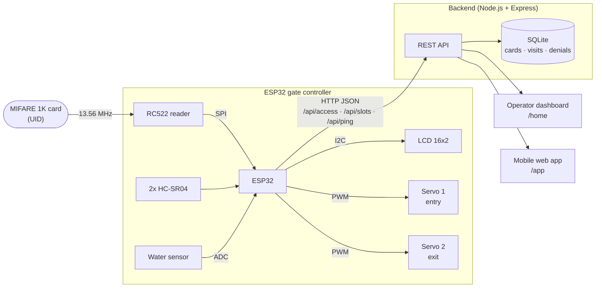

**Core rule: the server is the single source of truth.** Balance, status, owner and history live in the database, keyed by UID. The ESP32 never makes a financial decision. It sends the UID and obeys the reply. Without a network it switches to an **offline mode** and only admits cards from a list it saved earlier.

---

## Repository layout

```
.
├── firmware/
│   ├── smart_parking_final/   ← main ESP32 sketch (open smart_parking_final.ino)
│   ├── tests/                 ← 14 hardware test sketches, one per component / combination
│   └── archive/               ← first modular version of the firmware (v1)
├── backend/                   ← Express + SQLite API (source of truth)
│   └── test/api.test.js       ← automated end-to-end API test
├── frontend/                  ← operator dashboard, served at /home
├── mobile/                    ← mobile web app (public/ is served at /app)
│                                + standalone prototype server and its integration test
└── docs/
    ├── hardware/              ← wiring guide, scale-model plans, 3D holder brief
    └── images/                ← photos and screenshots
```

---

## Firmware (ESP32)

`firmware/smart_parking_final/` is a multi-tab Arduino sketch:

| Tab | Role |
|---|---|
| `Config.h` | Every pin, angle, timing and backend URL in one place |
| `smart_parking_final.ino` | Globals, HTTP helpers, `setup()` / `loop()` |
| `hardware.ino` | LCD, servos, HC-SR04, RC522 and water-sensor helpers |
| `gate.ino` | The gate flow: access request, 20 s code window, entry/exit barriers, slot reports, offline card list |
| `inspector.ino` | **Card Inspector**: dumps the 16 MIFARE sectors and writes encrypted data into a protected sector |
| `wifi.ino` | Setup portal: when no Wi-Fi is saved, the board opens the `Fati Parking` hotspot with a page at `192.168.4.1` |
| `serialcmd.ino` | Serial commands: `status`, `scan`, `ssid` / `pass` / `connect`, `offline` / `online`, `portal`, `close` |

### Pin map (validated on the board)

| Component | Signal → ESP32 pin |
|---|---|
| **RC522** (3.3 V only) | SDA/SS **5** · SCK **18** · MOSI **23** · MISO **19** · RST **22** |
| **LCD 16x2 I2C** (0x27) | SDA **21** · SCL **17** |
| **Servo 1**, entry barrier | **27** (closed 30°, open 95°) |
| **Servo 2**, exit barrier | **16** (closed 85°, open 0°) |
| **HC-SR04 #1**, covered slot | Trig **26** · Echo **25** (via 1k/2k divider) |
| **HC-SR04 #2**, outdoor slot | Trig **33** · Echo **32** (via 1k/2k divider) |
| **Water sensor** | S → **34** (analog, powered from 3V3) |

> ⚠️ **Upload tip:** flash the board with the **RC522 unplugged**, then plug it back in. Its SS line sits on the strapping pin GPIO5 and otherwise causes `flash read err` boot loops.

Libraries: **MFRC522** (GithubCommunity), **LiquidCrystal_I2C**, **ESP32Servo**. WiFi, WebServer, Preferences and HTTPClient ship with the ESP32 core.

The full step-by-step wiring guide is in [`docs/hardware/WIRING.md`](docs/hardware/WIRING.md).

### RFID security: Card Inspector

The admin can **arm** the gate from the dashboard. The next tap is then only *inspected*: no access request is made and no barrier moves.

- **Read:** dumps every sector that opens with the factory key and marks the protected ones.
- **Write:** the server encrypts up to 48 bytes of text (**AES-256-CTR**) and writes it into sector 1 to 15. The sector's Key A/B is replaced by a key derived (SHA-256) from a new **decryption code** `XXXX-XXXX`. The server only stores the ciphertext and a **scrypt hash** of the code, never the code itself.

---

## Backend (Node.js + SQLite)

`backend/server.js` is an Express app backed by SQLite. It uses the built-in `node:sqlite` on Node ≥ 22.13 and falls back to `better-sqlite3` on older Node versions.

| Endpoint | Used by | Purpose |
|---|---|---|
| `POST /api/access` | ESP32 | **The decision**: UID → allow/deny, `ENTRY` (+ code) or `EXIT` (+ duration, cost) |
| `GET /api/gate-status?code=` | ESP32 | Has the entry code been claimed in the app? |
| `POST /api/slots` | ESP32 | Slot occupancy + rain; the reply can carry an app exit or a Card Inspector job |
| `POST /api/ping` | ESP32 | Heartbeat (IP, RSSI, uptime, LCD/RFID/servo health) |
| `GET /api/gate/cards` | ESP32 | Approved UIDs, cached in flash for offline mode |
| `POST /api/login` | Dashboard / app | Admin login (bearer token) or mobile login with the 6-digit code |
| `GET /api/cards`, `GET /api/stays` | Dashboard | Cards (including unregistered scans) and the parking log |
| `POST /api/cards[/:uid]`, `/recharge`, `/block` | Dashboard (admin) | Register, edit, top up and block cards |
| `POST /api/inspect/arm` | Dashboard (admin) | Arm the Card Inspector |
| `GET /api/session`, `POST /api/sortie` | Mobile app | Live session, planned stay, "Quit parking" |

The full list with examples is served at **`/home/docs`**.

**Access rule:** a card may enter only if it is `ACTIVE`, has an owner name **and** a balance > 0. A car that is already inside can always leave. When it rains and the covered slot is taken, entry is refused with `Complet (pluie)`.

**Billing:** app stays are billed per hour from the balance (planned stay 1.00 DT/h, open-ended stay 1.50 DT/h). No-app stays cost 1 DT per started 30 minutes. A demo mode speeds the clock up ×60 so costs visibly climb during a presentation.

<p align="center">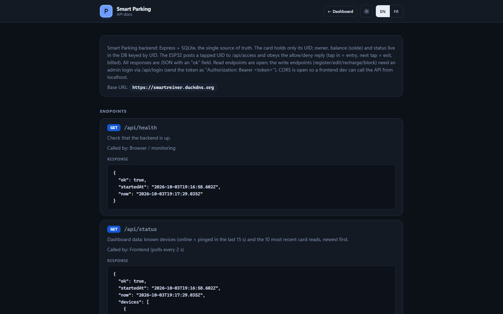</p>

---

## Frontend: operator dashboard

`frontend/` is a single-page operator console (English/French, light/dark), served at **`/home`** and refreshed every 2 s. Viewing is open to anyone; changes require the admin login.

| Overview: live lot, free slots, last card | Cards & clients |
|---|---|
| 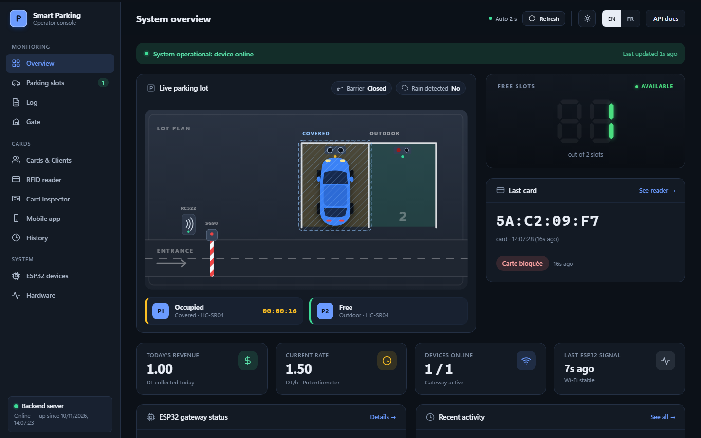 | 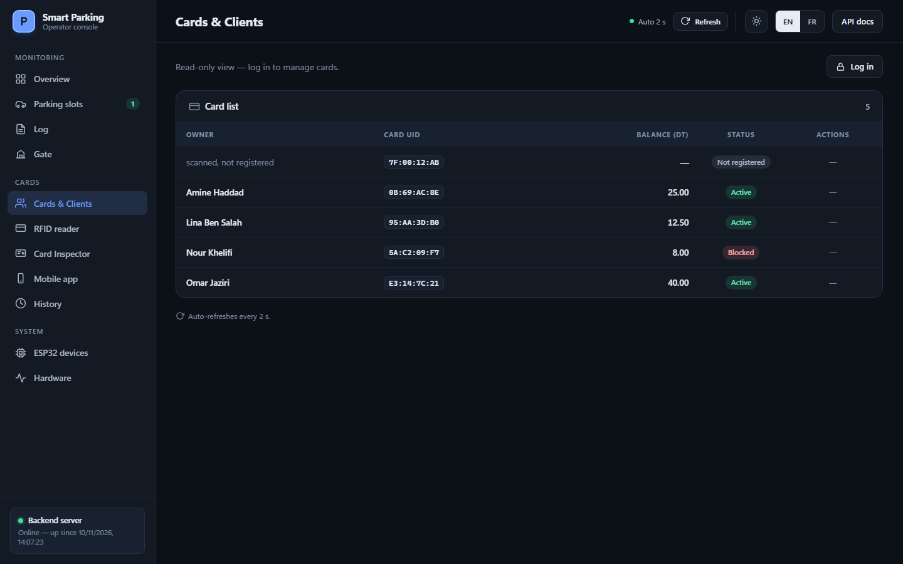 |
| **Gate & codes**: cars inside, mode, running cost | **Log**: entries, exits, denied taps with reason |
| 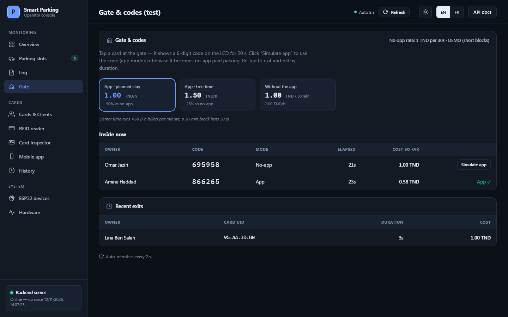 | 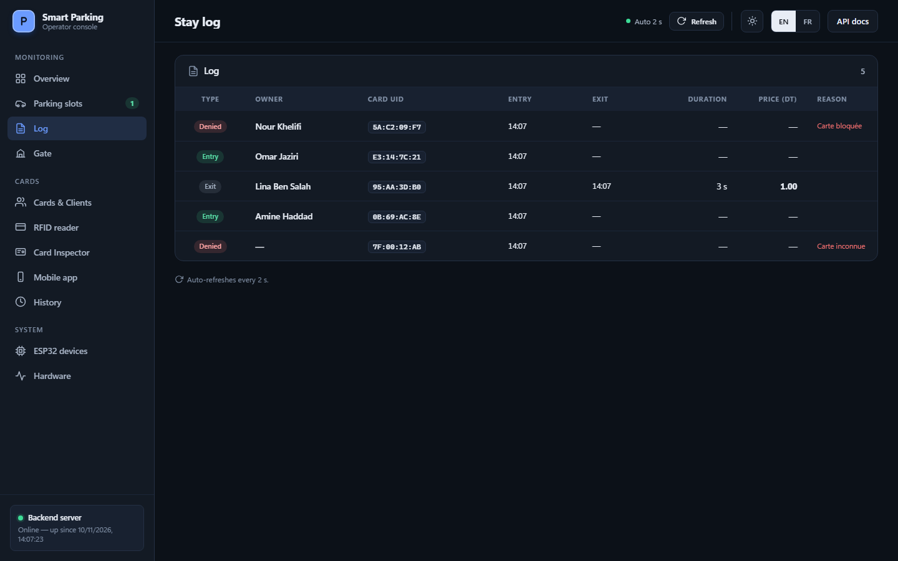 |

| Card Inspector: read the 16 sectors or write an encrypted value |
|---|
| 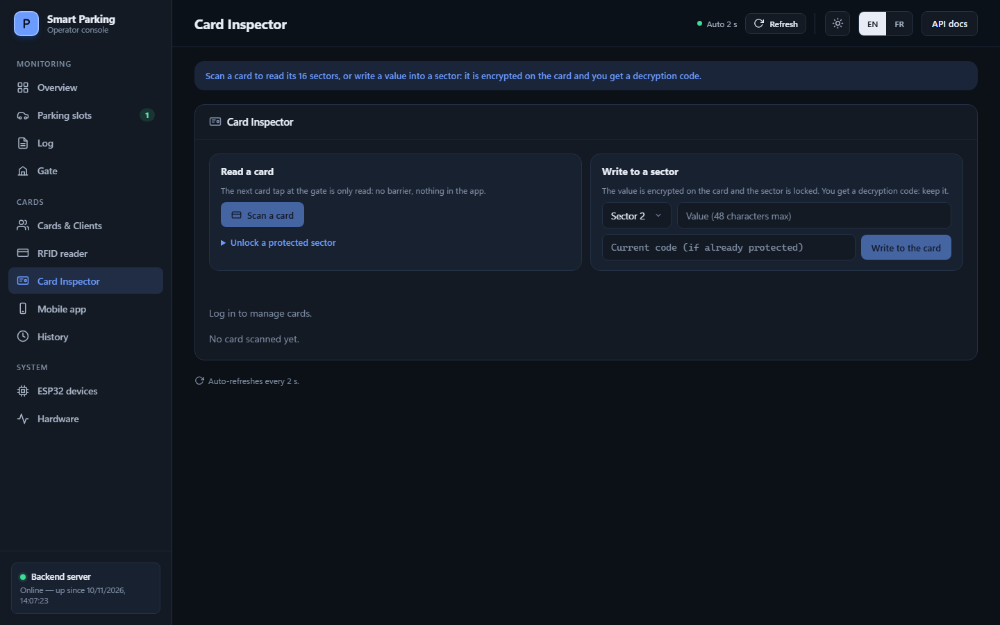 |

Other pages: parking slots, RFID reader (live scans), mobile-app QR code, history, ESP32 devices and hardware health.

---

## Frontend: mobile web app

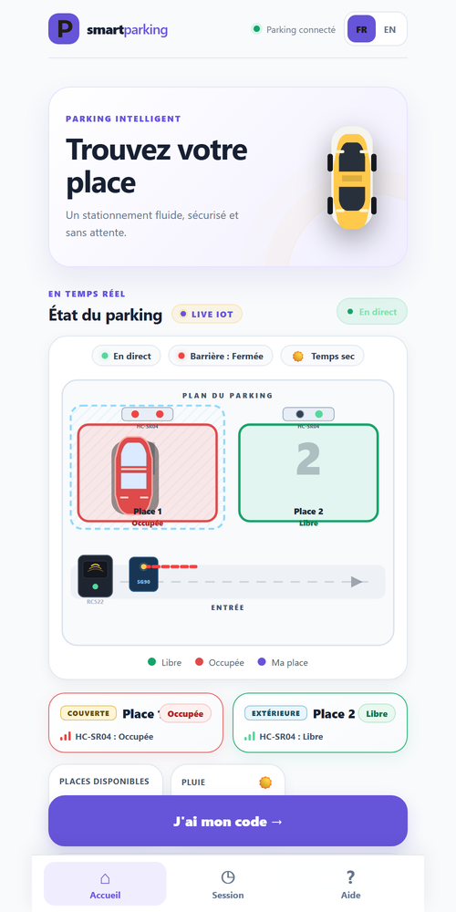

`mobile/public/` is the driver's app (French/English), served at **`/app`**:

- live lot plan with free/occupied slots, barrier state and rain status;
- **"J'ai mon code"**: log in with the 6-digit code shown on the LCD, which turns the stay into *app mode*;
- choose a planned stay (30/60/120/180 min) or open-ended time;
- live session timer and cost, plus **"Quit parking"**, which bills the stay and makes the ESP32 open the exit barrier.

The dashboard's *Mobile app* page shows a QR code that opens it.

`mobile/` also contains the team's first **standalone prototype** (`server.js`, dependency-free Node with JSON storage and CLI tools in `outils/`). It has its own integration test (see below).

<br clear="right">

---

## Tests

### Hardware: one sketch per component, then combined

Every part was proven on its own before going into the final firmware. All sketches are in [`firmware/tests/`](firmware/tests) and print their results to the Serial Monitor at 115200 baud.

| Sketch | What it proved |
|---|---|
| `rc522_test` | RC522 wiring over SPI; reads card UIDs |
| `card_dump_test` | Read-only dump of all 16 MIFARE sectors: which open with the factory key, which are protected |
| `rc522_lcd_test` | RC522 + I2C LCD on custom pins (SDA 21 / SCL 17): UID shown on the LCD |
| `water_sensor_test` | Analog water sensor on GPIO34: raw value + DRY/DAMP/WET |
| `rc522_lcd_water_test` | Reader + LCD + water sensor together |
| `servo_test`, `servo_sweep_check` | Both SG90s powered and moving (full sweeps, one at a time) |
| `servo_tune` | Interactive angle finder used to calibrate the barrier open/closed angles |
| `rc522_servo_test` | SPI and PWM at the same time: a tap opens a barrier |
| `rc522_lcd_water_servo_test` | Everything except the slot sensors, cumulatively |
| `hcsr04_one_test`, `hcsr04_test` | One, then both ultrasonic slot sensors through their voltage dividers |
| `rc522_hcsr04_test` | Reader + both slot sensors |
| `full_behavior_test` | **Full demo on the board**: tap → `Welcome` + entry barrier, next tap → `Goodbye` + exit barrier |
| `wiring_check` | Final self-test: I2C scan finds the LCD, RC522 version read, echoes from both HC-SR04, servo wiggle |

Lessons from these tests went straight into the design: GPIO14 next to strapping pin 12 caused boot loops, so servo 2 moved to **GPIO16**. The LCD clock moved to **GPIO17** because RC522 RST already uses the default SCL pin (22).

### Software: automated API tests

**Backend**: `backend/test/api.test.js` starts the real server on a throw-away database and replays a full gate cycle as the ESP32 would:

```bash
cd backend && npm install && npm test
```

```
✔ health check answers
✔ ESP32 heartbeat is accepted
✔ an unknown card is refused (no barrier)
✔ admin endpoints need a login
✔ wrong admin password is rejected, right one gives a token
✔ admin registers a card with an owner and a balance
✔ a registered card without balance is refused
✔ first tap = ENTRY with a 6-digit code for the LCD
✔ the code can be claimed (app mode) and the ESP32 sees it
✔ second tap = EXIT with duration and cost
✔ the stay shows up in the parking journal
✔ a blocked card is refused
ℹ tests 12 · pass 12 · fail 0
```

**Mobile prototype**: `mobile/test-integration.js` (device token, compact JSON for the ESP32 parser, sessions, card exit, blocked and unfunded cards, rain allocation):

```bash
cd mobile && npm test        # RÉSUMÉ FINAL : 9 / 9 TESTS RÉUSSIS
```

---

## Getting started

### 1. Backend + dashboard + mobile app

```bash
cd backend
npm install
ADMIN_SEED_PASSWORD=choose-one npm start      # PowerShell: $env:ADMIN_SEED_PASSWORD="choose-one"; npm start
```

The server prints its LAN URL, for example `http://192.168.1.20:3000`:

- dashboard → `http://<ip>:3000/home` (admin user `reiner`; if you don't set `ADMIN_SEED_PASSWORD`, a random password is printed on first start)
- mobile app → `http://<ip>:3000/app`
- API docs → `http://<ip>:3000/home/docs`

On Windows, allow Node through the firewall (private networks) so the ESP32 and phones can reach it. The database is created in `backend/data/` (git-ignored). `backend/ecosystem.config.js` is the pm2 config used to deploy it behind nginx.

### 2. Firmware

1. Install **Arduino IDE 2.x** and the **esp32 by Espressif** board package, plus the libraries **MFRC522**, **LiquidCrystal_I2C** and **ESP32Servo**.
2. Open `firmware/smart_parking_final/smart_parking_final.ino` and set `BACKEND` in `Config.h` to your server URL.
3. Board: *ESP32 Dev Module*. **Unplug the RC522**, upload, then plug it back in.
4. On first boot, join the `Fati Parking` hotspot and open `192.168.4.1` to pick your Wi-Fi (2.4 GHz). You can also use the `ssid` / `pass` / `connect` serial commands.
5. Serial Monitor at **115200**: tap a card and watch `[HTTP] POST /api/access -> 200 …`.

---

## Hardware build

| Bill of materials | Qty |
|---|---|
| ESP32-S (NodeMCU-32S) | 1 |
| RC522 RFID reader + MIFARE Classic 1K cards | 1 + 5 |
| SG90 micro servo (entry / exit barriers) | 2 |
| LCD 16x2 with I2C backpack | 1 |
| HC-SR04 ultrasonic sensor (+ 1 kΩ / 2 kΩ divider each) | 2 |
| Analog water / rain sensor | 1 |
| Breadboards, jumpers, laser-cut MDF scale model | – |

| Wiring under the board | HC-SR04 slot sensors + echo dividers |
|:---:|:---:|
| 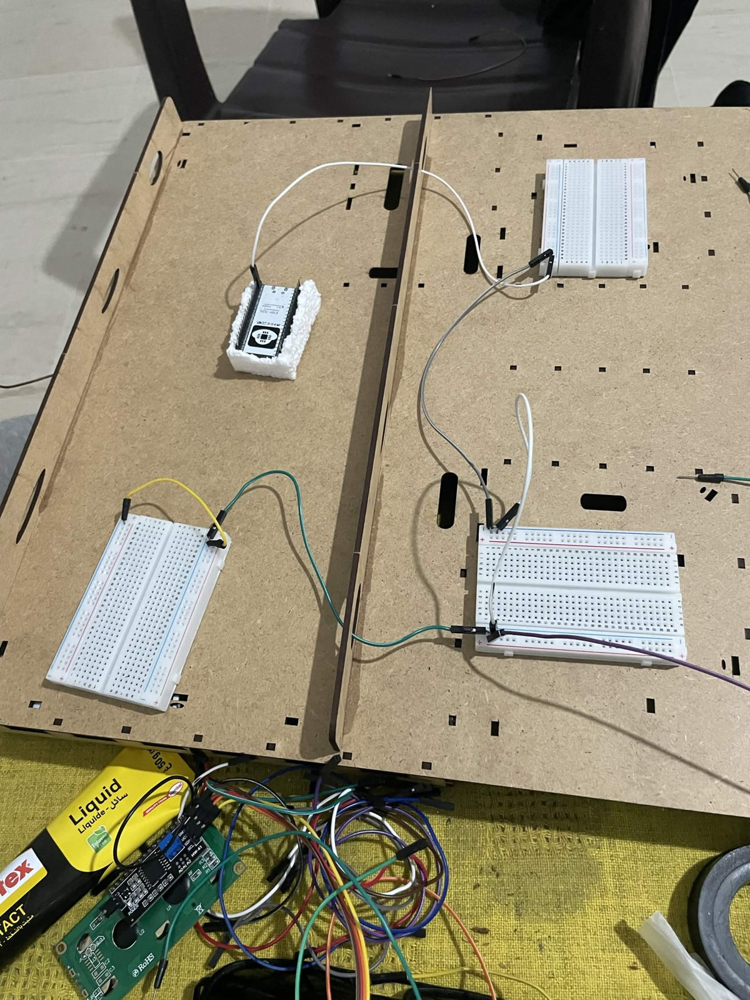 | 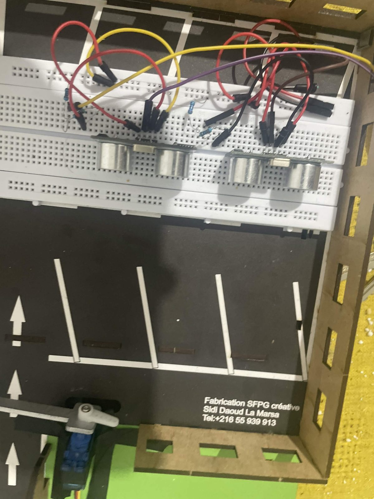 |
| **SG90 barrier servo** | **Rain sensor on its MDF mount** |
| 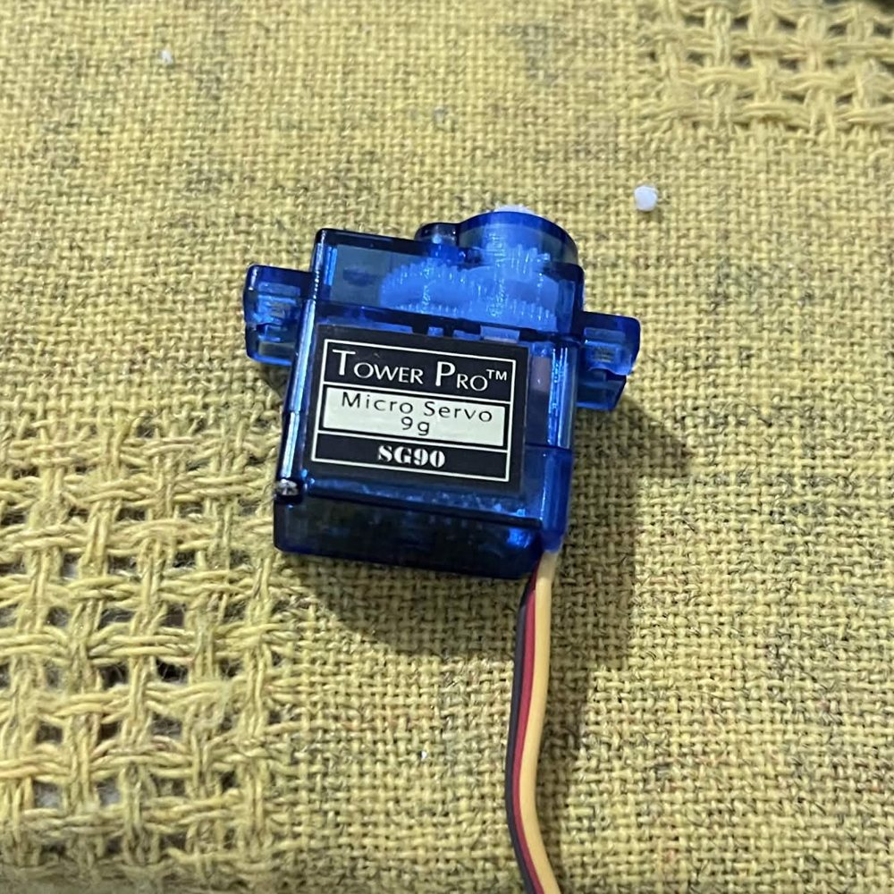 | 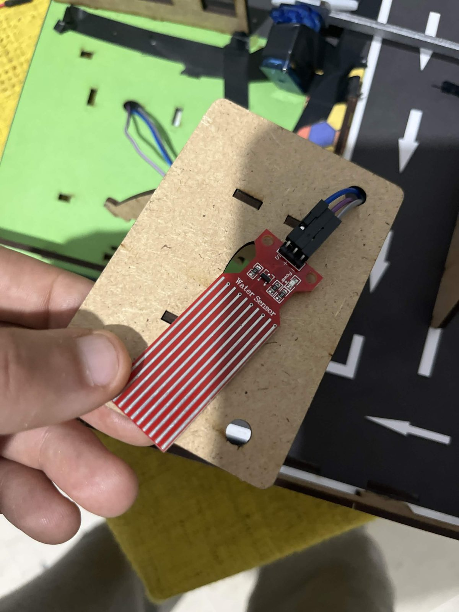 |

More in [`docs/hardware/`](docs/hardware): wiring guide, plan and 3D views of the model (`maquette-plan.svg`, `maquette-3d.svg`) and the 3D-holder design brief.

---

## License

[MIT](LICENSE) © 2026 Youssef Timoumi

---

<div align="center">

Built as an RFID/NFC course project · 2026

</div>
